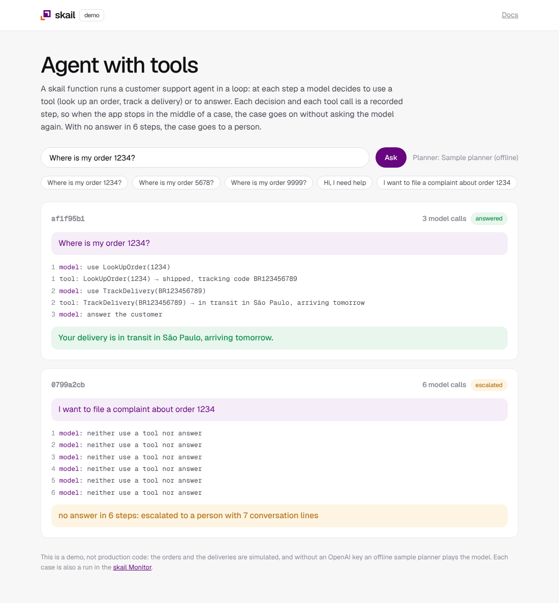

# skail agent with tools (.NET 8)

[Português (Brasil)](README.pt-BR.md)

An app with a skail function that runs a customer support agent in a loop: at each step a model decides to use a tool (look up an order, track a delivery) or to answer the customer. Each decision and each tool call is a recorded step, so when the app stops in the middle of a case, the case goes on after the last recorded step without asking the model again. With no answer in 6 steps, the case goes to a person. With an OpenAI key the model is OpenAI; without one, an offline sample planner decides, so the demo needs no other account. You ask as the customer on a page the app serves at http://localhost:8080.

It shows three skail features:

- an **AI agent with tools**: the model call and each tool call are commands, and the loop is plain code in the function;
- **replay**: the function only reads recorded results, so a resumed case rebuilds the conversation without calling the model again;
- **automatic retries**: a failed model call is retried, and the tools only read data, so retrying them has no side effect.

## Requirements

- One of: [Docker](https://docs.docker.com/get-docker/), [Podman](https://podman.io/docs/installation) or the [.NET 8 SDK](https://dotnet.microsoft.com/download/dotnet/8.0) (or newer). The run script uses the first one it finds.
- A skail environment with a workload registered for the `SKAIL_WORKLOAD` in `.env` (`agentwithtools:v1.0.0` by default). The [Quickstart](https://docs.skail.dev/comece-aqui/quickstart) shows how to create the account, the environment and the workload.
- Optional: an OpenAI API key, in `OPENAI_API_KEY` (and the model in `OPENAI_MODEL`, `gpt-4o-mini` by default).

The project uses `Skail.Platform.Runtime` **2.3.0-rc.4**.

## Run

```bash
cp .env.example .env  # fill in SKAIL_SIDECAR, SKAIL_NAMESPACE and SKAIL_KEY (portal > Environments & keys > Connect)
scripts/run.sh        # then open http://localhost:8080
```

On Windows, in PowerShell: `copy .env.example .env`, then `powershell -ExecutionPolicy Bypass -File scripts\run.ps1`. The script works on the Windows PowerShell built into Windows; PowerShell 7 is not needed.

The script runs the demo with what the machine has: Docker, then Podman, then the .NET SDK. If it finds none of them, it says what to install. Without the script, the commands are `dotnet run`.



Type the customer's message, or click one of the examples, and click **Ask**. Each case shows the steps of the agent as they happen: what the model decided and what each tool answered, how many times the model was called, and how the case ended. The page refreshes itself every second, and each step is also printed to the console.

## The paths

The sample planner reads the message: with an order number it looks up the order, follows the tracking code when there is one, and answers; without a number it asks for one; and a message with the word "complaint" never gets an answer, to show the handoff. It takes 1.5 seconds per decision, like a model would.

| What you ask | What happens | Result |
|---|---|---|
| "Where is my order 1234?" | `LookUpOrder(1234)`, then `TrackDelivery(BR123456789)`, then the answer | **answered** in 3 steps: "Your delivery is in transit in São Paulo, arriving tomorrow." |
| "Where is my order 5678?" | `LookUpOrder(5678)`; the order has no tracking code yet | **answered** in 2 steps |
| "Where is my order 9999?" | `LookUpOrder(9999)` does not find the order | **answered** in 2 steps: asks the customer to check the number |
| "Hi, I need help" | there is no order number | **answered** in 1 step: asks for the number |
| "I want to file a complaint about order 1234" | 6 decisions with neither a tool nor an answer | **escalated** to a person, with the conversation |

With `OPENAI_API_KEY` set, an OpenAI model decides with the same tools, and the wording of its answers varies. The page shows which planner is in use.

## How it works

The app does three jobs in one process: it serves the page, it hosts the worker that runs the function (`builder.UseSkail()`), and it starts each case through the skail HTTP API.

```http
POST {SKAIL_SIDECAR}/api/v1/trigger/agentwithtools/v1.0.0/AssistCustomer/{caseId}
["{caseId}", "Where is my order 1234?"]
```

The function, in [`SupportAgent.cs`](SupportAgent.cs):

```csharp
[SkailFunction]
public async SkailTask<CaseResult> AssistCustomer(string caseId, string question)
{
    var conversation = new List<string> { $"customer: {question}" };

    for (var step = 1; step <= AgentLimits.MaxSteps; step++)
    {
        var decision = await DecideNextStep(caseId, step, conversation.ToArray());
        if (decision.Answer is not null)
            return await Answer(caseId, step, decision.Answer);

        if (decision.Tool is null)
        {
            conversation.Add(InvalidDecisionWarning);
            continue;
        }

        var result = await UseTool(caseId, step, decision.Tool, decision.Argument ?? "");
        conversation.Add($"{decision.Tool}({decision.Argument}) => {result}");
    }

    return await EscalateToHuman(caseId, conversation.ToArray());
}
```

- The loop, the `if` and the `continue` are plain code. The model (`DecideNextStep`) and the tools (`UseTool`) run only in commands, and the function reads their recorded results.
- When a case resumes, the function runs again from the start: each finished command returns its recorded result, the conversation is rebuilt the same way, and only the step that had not finished runs. That is why the model is asked once per step, even after a restart.
- Each `DecideNextStep` gets its own copy of the conversation, because the arguments of a command are recorded and must not change afterwards.
- A decision with neither a tool nor an answer is not an error: the function adds a warning to the conversation and asks again, which uses up a step. An unknown tool is also text for the model. A model call that fails throws, and skail retries `DecideNextStep` up to 3 times.
- The planners are in `Demo/Planners.cs`. The OpenAI key goes only in the request header: it is never printed nor recorded in the run history.

| File | What it has |
|---|---|
| `SupportAgent.cs` | The function and its commands. |
| `Model.cs` | The tools, the decision of the model and the result of the case. |
| `Demo/Planners.cs` | The offline sample planner and the OpenAI one. |
| `Demo/SimulatedOrderSystem.cs` | The simulated orders and deliveries the tools read. |
| `Demo/CaseDesk.cs` | Starts the cases for the page and keeps each step. |
| `Page/index.html` | The page, with the skail branding. |
| `Skail/SkailApiClient.cs` | The trigger through the skail HTTP API. |
| `Program.cs` | Reads `.env`, picks the planner, serves the page and its API, and wires everything up. |
| `scripts/run.sh`, `scripts/run.ps1`, `Dockerfile` | Run the demo with Docker, Podman or .NET, whatever the machine has. |

## See the durability

1. Run `scripts/run.sh`, open the page and ask "Where is my order 1234?".
2. After the first step, press **Ctrl+C**. The app closes; the case stays in skail.
3. Run `scripts/run.sh` again and open the page. skail hands the app the case: it goes on after the last recorded step and is answered. The page counts the model calls made after the restart: only for the steps that had not been decided. A step that was in the middle of its command when the app closed can take a few minutes to be handed out again; the case waits for it.

In the portal, open the [Monitor](https://docs.skail.dev/referencia/portal/monitor) of your environment and click the case: it lists each `DecideNextStep` and `UseTool` in order, then `Answer` or `EscalateToHuman`, each with its arguments and result.

## Notes

- Apps running the same `SKAIL_WORKLOAD` on the same environment share the same runs: use one workload (or environment) per person.

## Disclaimer

**This is a demo, not production code.** It exists only to show how [skail](https://docs.skail.dev) works and is provided "as is", without warranty of any kind. The orders and the deliveries are simulated. With an OpenAI key, each decision is a paid call to OpenAI, and what the customer types is sent to it.

## License

[Apache-2.0](LICENSE)
