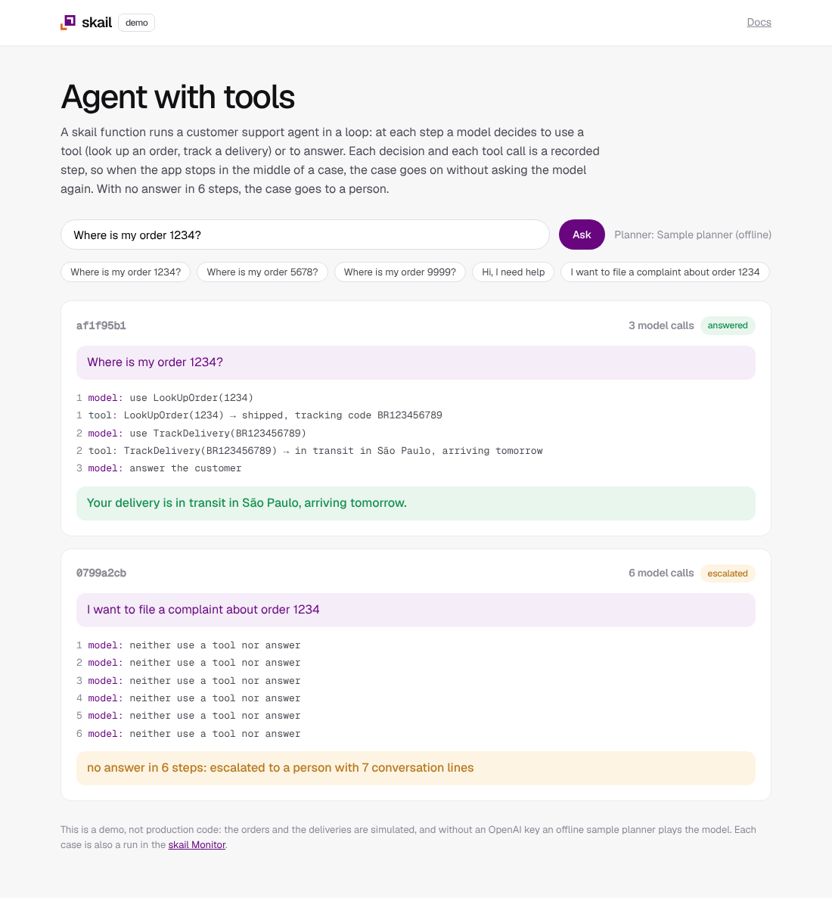

# skail agent with tools (.NET 8)

[English](README.md)

Um app com uma function do skail que roda um agente de atendimento num laço: a cada passo, um modelo decide usar uma ferramenta (consultar um pedido, rastrear uma entrega) ou responder ao cliente. Cada decisão e cada uso de ferramenta é um passo registrado, então, quando o app para no meio de um caso, o caso continua depois do último passo registrado sem perguntar de novo ao modelo. Sem resposta em 6 passos, o caso vai para uma pessoa. Com uma chave da OpenAI, o modelo é o da OpenAI; sem ela, um planejador de exemplo, offline, decide, então a demo não precisa de outra conta. Você pergunta como cliente numa página que o app serve em http://localhost:8080.

Ele mostra três recursos do skail:

- um **agente de IA com ferramentas**: a chamada ao modelo e cada uso de ferramenta são commands, e o laço é código comum na function;
- **replay**: a function só lê resultados registrados, então um caso retomado reconstrói a conversa sem chamar o modelo de novo;
- **novas tentativas automáticas**: uma chamada ao modelo que falha é tentada de novo, e as ferramentas só leem dados, então repeti-las não tem efeito colateral.

## Requisitos

- Um destes: [Docker](https://docs.docker.com/get-docker/), [Podman](https://podman.io/docs/installation) ou o [SDK do .NET 8](https://dotnet.microsoft.com/download/dotnet/8.0) (ou mais novo). O script de execução usa o primeiro que encontrar.
- Um environment do skail com um workload registrado para o `SKAIL_WORKLOAD` do `.env` (`agentwithtools:v1.0.0` por padrão). O [Quickstart](https://docs.skail.dev/comece-aqui/quickstart) mostra como criar a conta, o environment e o workload.
- Opcional: uma chave da API da OpenAI, em `OPENAI_API_KEY` (e o modelo em `OPENAI_MODEL`, `gpt-4o-mini` por padrão).

O projeto usa o `Skail.Platform.Runtime` **2.3.0-rc.4**.

## Rodar

```bash
cp .env.example .env  # preencha SKAIL_SIDECAR, SKAIL_NAMESPACE e SKAIL_KEY (portal > Environments & keys > Connect)
scripts/run.sh        # depois abra http://localhost:8080
```

No Windows, no PowerShell: `copy .env.example .env` e depois `powershell -ExecutionPolicy Bypass -File scripts\run.ps1`. O script funciona no Windows PowerShell que já vem no Windows; não precisa do PowerShell 7.

O script roda a demo com o que a máquina tiver: Docker, depois Podman, depois o SDK do .NET. Se não achar nenhum, ele diz o que instalar. Sem o script, os comandos são `dotnet run`.



Digite a mensagem do cliente, ou clique num dos exemplos, e clique em **Ask**. Cada caso mostra os passos do agente conforme acontecem: o que o modelo decidiu e o que cada ferramenta respondeu, quantas vezes o modelo foi chamado e como o caso terminou. A página se atualiza sozinha a cada segundo, e cada passo também aparece no console.

## Os caminhos

O planejador de exemplo lê a mensagem: com um número de pedido, ele consulta o pedido, segue o código de rastreio quando há um e responde; sem número, ele pede o número; e uma mensagem com a palavra "complaint" nunca recebe resposta, para mostrar a passagem para uma pessoa. Ele leva 1,5 segundo por decisão, como um modelo levaria.

| O que você pergunta | O que acontece | Resultado |
|---|---|---|
| "Where is my order 1234?" | `LookUpOrder(1234)`, depois `TrackDelivery(BR123456789)`, depois a resposta | **answered** em 3 passos: "Your delivery is in transit in São Paulo, arriving tomorrow." |
| "Where is my order 5678?" | `LookUpOrder(5678)`; o pedido ainda não tem código de rastreio | **answered** em 2 passos |
| "Where is my order 9999?" | `LookUpOrder(9999)` não encontra o pedido | **answered** em 2 passos: pede ao cliente para conferir o número |
| "Hi, I need help" | não há número de pedido | **answered** em 1 passo: pede o número |
| "I want to file a complaint about order 1234" | 6 decisões sem ferramenta nem resposta | **escalated** para uma pessoa, com a conversa |

Com `OPENAI_API_KEY` preenchida, um modelo da OpenAI decide com as mesmas ferramentas, e o texto das respostas varia. A página mostra qual planejador está em uso.

## Como funciona

O app faz três coisas no mesmo processo: serve a página, hospeda o worker que executa a function (`builder.UseSkail()`) e inicia cada caso pela API HTTP do skail.

```http
POST {SKAIL_SIDECAR}/api/v1/trigger/agentwithtools/v1.0.0/AssistCustomer/{caseId}
["{caseId}", "Where is my order 1234?"]
```

A function, em [`SupportAgent.cs`](SupportAgent.cs):

```csharp
[SkailFunction]
public async SkailTask<CaseResult> AssistCustomer(string caseId, string question)
{
    var conversation = new List<string> { $"customer: {question}" };

    for (var step = 1; step <= AgentLimits.MaxSteps; step++)
    {
        var decision = await DecideNextStep(caseId, step, conversation.ToArray());
        if (decision.Answer is not null)
            return await Answer(caseId, step, decision.Answer);

        if (decision.Tool is null)
        {
            conversation.Add(InvalidDecisionWarning);
            continue;
        }

        var result = await UseTool(caseId, step, decision.Tool, decision.Argument ?? "");
        conversation.Add($"{decision.Tool}({decision.Argument}) => {result}");
    }

    return await EscalateToHuman(caseId, conversation.ToArray());
}
```

- O laço, o `if` e o `continue` são código comum. O modelo (`DecideNextStep`) e as ferramentas (`UseTool`) rodam só em commands, e a function lê os resultados registrados deles.
- Quando um caso é retomado, a function roda de novo desde o começo: cada command que terminou devolve o resultado registrado, a conversa é reconstruída do mesmo jeito, e só o passo que não tinha terminado roda. Por isso o modelo é chamado uma vez por passo, mesmo depois de um reinício.
- Cada `DecideNextStep` recebe a sua própria cópia da conversa, porque os argumentos de um command são registrados e não podem mudar depois.
- Uma decisão sem ferramenta nem resposta não é erro: a function acrescenta um aviso à conversa e pergunta de novo, o que gasta um passo. Uma ferramenta desconhecida também vira texto para o modelo. Uma chamada ao modelo que falha lança exceção, e o skail tenta o `DecideNextStep` de novo até 3 vezes.
- Os planejadores estão em `Demo/Planners.cs`. A chave da OpenAI vai só no cabeçalho da requisição: nunca é impressa nem registrada no histórico da execução.

| Arquivo | O que tem |
|---|---|
| `SupportAgent.cs` | A function e os commands dela. |
| `Model.cs` | As ferramentas, a decisão do modelo e o resultado do caso. |
| `Demo/Planners.cs` | O planejador de exemplo, offline, e o da OpenAI. |
| `Demo/SimulatedOrderSystem.cs` | Os pedidos e as entregas simulados que as ferramentas leem. |
| `Demo/CaseDesk.cs` | Inicia os casos da página e guarda cada passo. |
| `Page/index.html` | A página, com a marca do skail. |
| `Skail/SkailApiClient.cs` | O trigger pela API HTTP do skail. |
| `Program.cs` | Lê o `.env`, escolhe o planejador, serve a página e a API dela, e liga tudo. |
| `scripts/run.sh`, `scripts/run.ps1`, `Dockerfile` | Rodam a demo com Docker, Podman ou o .NET, o que houver na máquina. |

## Veja a durabilidade

1. Rode `scripts/run.sh`, abra a página e pergunte "Where is my order 1234?".
2. Depois do primeiro passo, aperte **Ctrl+C**. O app fecha; o caso continua no skail.
3. Rode `scripts/run.sh` de novo e abra a página. O skail entrega o caso ao app: ele continua depois do último passo registrado e é respondido. A página conta as chamadas ao modelo feitas depois do reinício: só as dos passos que ainda não tinham sido decididos. Um passo que estava no meio do command quando o app fechou pode levar alguns minutos para ser entregue de novo; o caso espera por ele.

No portal, abra o [Monitor](https://docs.skail.dev/referencia/portal/monitor) do seu environment e clique no caso: ele lista cada `DecideNextStep` e `UseTool` em ordem, depois `Answer` ou `EscalateToHuman`, cada um com os seus argumentos e resultado.

## Observações

- Apps rodando o mesmo `SKAIL_WORKLOAD` no mesmo environment dividem as mesmas execuções: use um workload (ou environment) por pessoa.

## Aviso

**Esta é uma demonstração, não é código de produção.** Ela existe só para mostrar como o [skail](https://docs.skail.dev) funciona e é fornecida "como está", sem garantia de nenhum tipo. Os pedidos e as entregas são simulados. Com uma chave da OpenAI, cada decisão é uma chamada paga à OpenAI, e o que o cliente digita é enviado a ela.

## Licença

[Apache-2.0](LICENSE)
